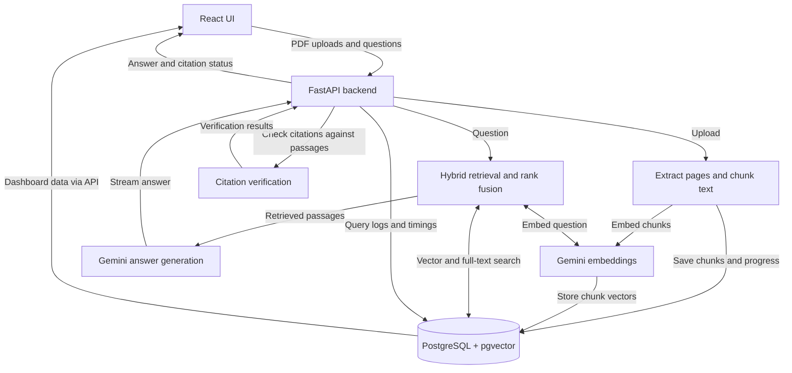

# PaperTrail

Ask questions about your PDFs and get streamed answers with page citations you can inspect.
Built with React, FastAPI, PostgreSQL + pgvector, and Gemini.

## Key features

- **Hybrid retrieval:** combines vector similarity and PostgreSQL full-text search using Reciprocal Rank Fusion.
- **Citation verification:** checks cited pages against retrieved passages and flags unmatched citations. This checks provenance, not factual correctness.
- **Resumable ingestion:** saves chunks before embedding, so interrupted uploads or quota failures can resume without repeating completed work.
- **Instrumentation:** tracks retrieval quality, latency, token usage, estimated cost, and failures, with structured logs, Prometheus metrics, and optional OpenTelemetry export.

## Architecture



Ingestion runs as an in-process background task. After a restart, interrupted documents
are marked failed and can be resumed through `POST /api/documents/{id}/resume`.

## Run locally

Requires Docker, Python 3.11+, Node.js compatible with Vite 8, and a
[Gemini API key](https://aistudio.google.com/apikey).

From the repository root:

```bash
cp .env.example .env
# Set GEMINI_API_KEY in .env before starting the backend.
docker compose up -d

python3 -m venv .venv
./.venv/bin/pip install -r requirements.txt
./.venv/bin/uvicorn backend.main:app --reload --port 8000
```

In a second terminal:

```bash
cd frontend
npm install
npm run dev
```

Open **http://localhost:5173**. Use **Ask** to upload and question documents, and
**Instrumentation** to inspect traffic. PostgreSQL runs on port **5433**; the schema
is applied automatically at backend startup.

See [.env.example](.env.example) for database and model settings. Minute-level quota
limits are retried; daily embedding quota exhaustion leaves progress saved for later
resume. Embedding token counts and costs shown in the dashboard are estimates.

Health: `http://localhost:8000/api/health`. Prometheus: `http://localhost:8000/metrics`.
Set `OTEL_EXPORTER_OTLP_ENDPOINT` to enable trace export.

## Checks and evaluation

Run module self-checks from the repository root:

```bash
for module in gemini ingest citations retrieval stats obs ratelimit; do
  ./.venv/bin/python -m backend.$module || break
done
```

Database and Gemini checks require running PostgreSQL and a valid API key; API calls
consume quota. For the 20-question evaluation, first download the PDFs using the
[corpus instructions](backend/eval/corpus/README.md), then run:

```bash
./.venv/bin/python -m backend.eval.run_eval --retrieval-only
./.venv/bin/python -m backend.eval.run_eval
```

The evaluation compares vector-only and hybrid retrieval; the full run also generates
and grades answers with Gemini.

## Limitations

Designed for local, single-user use: no authentication, user isolation, dedicated
background worker, OCR for scanned PDFs, or conversation memory. Query logs retain
question text and retrieval metadata without a retention policy; passage contents
are not logged.
